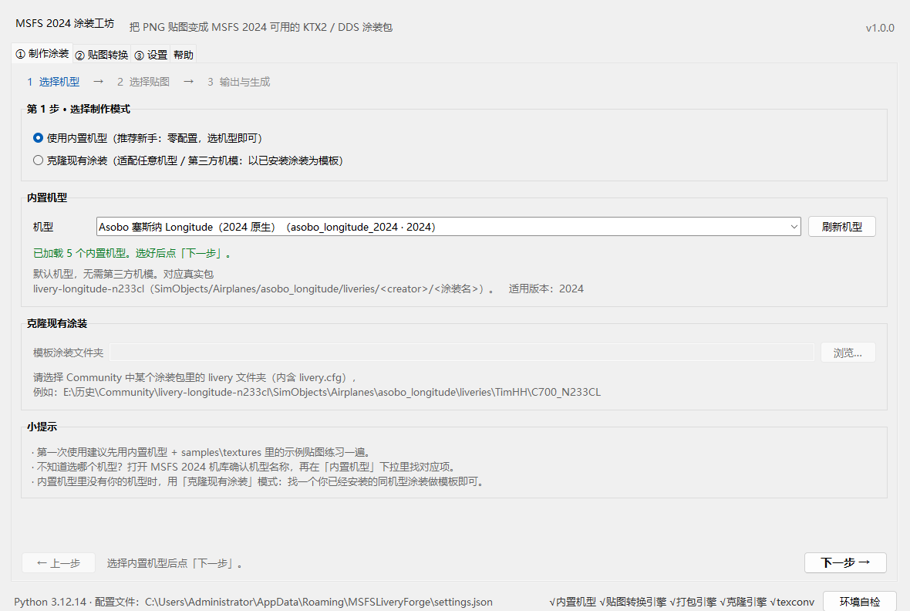
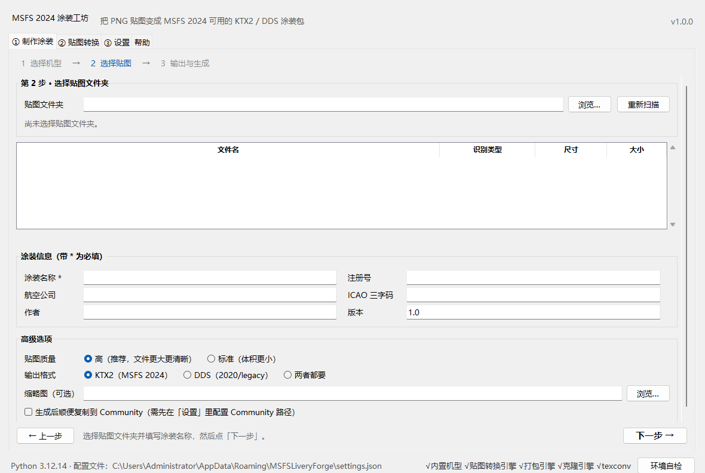

# MSFS Livery Forge · MSFS 2024 Livery Workshop

> A small **desktop tool** for creating liveries for *Microsoft Flight Simulator 2024*:
> you only need to prepare your PNG/TIF textures — the tool compresses them into the
> **KTX2 / DDS** formats the sim expects, and packages them into a complete livery
> that can be dropped straight into your **Community** folder.
> No internet access required, and **no Python installation required**.

> 简体中文版：[README.md](README.md)



## What is this? (in one sentence)

**You bring the textures; the tool does the rest.** There are two ways to work:

1. **Built-in aircraft**: pick an aircraft → pick your texture folder → enter a livery name → generate. Best for beginners; zero configuration.
2. **Clone an existing livery**: use any installed livery as a template → replace its textures with yours → generate.  
   Ideal for third-party aircraft and aircraft that have no built-in template.

> Just want to convert PNG to KTX2/DDS without packaging? Use the **Texture Convert** tab.

## System requirements

| Item | Requirement |
|---|---|
| OS | Windows 10 / 11 (64-bit) |
| Game | **Optional.** Generating a livery does not require the sim to be running; you only need MSFS 2024 to install it (same for the 2020 DDS mode) |
| Python | **Not required** — a portable runtime is bundled in `runtime\` (about 56 MB) |
| GPU / driver | No special requirement (compression uses the bundled `tools\texconv\texconv.exe`) |
| Disk space | Release package about 60 MB (runtime, compressor and samples); about 80 MB after extraction |
| Network | **Not required** — the tool does not access the network |
| Display | 1366×768 or larger recommended (main window minimum: 1100×760) |

> ⚠ If you move the project folder, **move the whole folder together** and keep the
> relative positions of `runtime\`, `tools\` and `liveryforge\`; otherwise the launcher
> cannot find the runtime.

## Five-minute quick start

### Step 0: Launch

Double-click **`run_gui.bat`** in the project root (a console window will appear — this is
normal; it shows the logs). If your antivirus flags it, see “FAQ” at the end.

> On a machine without a graphical environment (e.g. a remote terminal), use the command
> line instead: `run_cli.bat --help`.

### Path A: use a built-in aircraft (recommended for your first try)

1. Open the **“① Make Livery”** tab and choose **“Use built-in aircraft”**;
2. Pick an aircraft from the **Aircraft** drop-down (if you have no third-party aircraft,
   **start with the Asobo Cessna Longitude**);
3. Click **Next**;
4. On **“② Select Textures”**, click **Browse…** next to *Texture folder* and select your
   PNG/TIF folder (`samples\textures` is a good practice set);
   - the list shows file name, detected type (ALBD/COMP/NORM…), dimensions and size;
5. Enter the **Livery name** (required); optionally fill in registration, airline,
   ICAO code and author;
6. Click **Next** → choose the **Output folder** → click **⚙ Generate Livery**;
7. When it finishes, click **Open output folder** to inspect the package, or
   **Copy to Community** to install it.

### Path B: clone an existing livery (for third-party aircraft)

1. Choose the **“Clone existing livery”** mode;
2. For **Template livery folder**, select the inner livery folder of an **installed**
   livery, for example:

   ```
   E:\History\Community\livery-longitude-n233cl\SimObjects\Airplanes\asobo_longitude\liveries\TimHH\C700_N233CL
   ```

   Rule of thumb: the folder must contain **`livery.cfg`**;
3. Select your new texture folder, enter the livery name and output folder, then generate;
4. The tool copies the template structure and any textures you did not replace, swaps in
   your converted versions of same-named textures, and updates the livery name,
   registration and related fields.

### Path C: convert textures only

1. Open the **“② Texture Convert”** tab;
2. Choose the **texture folder** and **output folder**;
3. Choose a format: `KTX2 (MSFS 2024)` / `DDS (2020/legacy)` / `Both`;
4. Click **Start conversion**; when done, click **Open output folder** and copy the
   `.KTX2` / `.DDS` files into the livery package’s `texture\` folder.



### Make the sim recognize your livery

1. On the **“③ Settings”** tab, set the **Community folder** (the **Auto-detect** button
   usually finds it);
2. After generating, click **Copy to Community** (or manually copy the generated package
   folder into Community);
3. Start MSFS 2024 → the new livery appears in the hangar / livery selection screen.

> The 2024 Community folder is usually `…\Community`; some installations use `…\Community2024`.
> Trust the result of **Auto-detect** on the Settings tab, or select the folder manually.

## What gets generated

### MSFS 2024 native package (KTX2)

```
<output folder>\<package name>\
├─ manifest.json          package info (content_type is LIVERY or AIRCRAFT, depending on the aircraft)
├─ layout.json            file manifest (sizes / FILETIME)
└─ SimObjects\Airplanes\<aircraft>\liveries\<author>\<livery name>\
   ├─ livery.cfg          livery name / registration / airline / ICAO, etc.
   ├─ texture\            *.PNG.KTX2 + *.PNG.KTX2.json (+ optional texture.cfg fallbacks)
   └─ thumbnail\          thumbnail.png / thumbnail_small.png, etc.
```

### MSFS 2020 legacy package (DDS)

```
<output folder>\<package name>\
└─ SimObjects\Airplanes\<variant name>\
   ├─ aircraft.cfg
   └─ TEXTURE.<code>\     *.PNG.DDS + *.DDS.json + texture.CFG + thumbnail*.jpg
```

> `.KTX2.json` / `.DDS.json` are metadata required by the sim to read texture parameters —
> **do not delete them**.

## Built-in aircraft (5)

| Aircraft id | Name | Target version | Extra dependency |
|---|---|---|---|
| `asobo_longitude_2024` | Asobo Cessna Citation Longitude | 2024 | None (included with the sim — **start here**) |
| `fbw_a380x_2024` | FlyByWire A380X | 2024 | Requires the free FBW A380X aircraft add-on |
| `pmdg_777_2024` | PMDG 777-300ER | 2024 | Requires PMDG 777-300ER; `required_tags` `b77w_ext,engine_gew` (cloning recommended, see below) |
| `ini_a350_900_2024` | iniBuilds A350-900 | 2024 | Requires iniBuilds A350-900; `required_tags` `ext_a359` |
| `fbw_a320neo_2020` | FlyByWire A320neo | 2020 legacy (DDS) | Requires FBW A320neo (generates a DDS-mode package) |

> If you do not have the matching third-party aircraft: **use the Longitude**, or use the
> **Clone existing livery** mode for any aircraft.
> **Liveries for aircraft such as the PMDG 777 and iniBuilds A350 usually include
> vendor-specific files** (for example PMDG’s `livery.json` and `model.airframe/`).
> A built-in profile generates a plain livery package; if the livery does not show up in
> the hangar, switch to the clone mode and use an installed livery of the same aircraft as
> the template — that inherits every template file.
> For the complete/current list, run `python -m liveryforge list-profiles`.

## Command line (advanced users)

Double-click `run_cli.bat` (with no arguments it prints help and pauses), or run it from a
Command Prompt in the project root:

```bat
:: List built-in aircraft
run_cli.bat list-profiles

:: Detect Community / texconv / engine status
run_cli.bat detect

:: Convert textures only (KTX2 + DDS)
run_cli.bat convert samples\textures -o output\textures --format both

:: Build a livery with a built-in aircraft
run_cli.bat build --profile asobo_longitude_2024 --textures samples\textures -o output --title "My Livery" --atc-id B-1234 --author "Your Name"

:: Clone an existing livery
run_cli.bat clone --template "E:\History\Community\livery-longitude-n233cl\SimObjects\Airplanes\asobo_longitude\liveries\TimHH\C700_N233CL" --textures samples\textures -o output --title "Cloned Livery"
```

Equivalent Python form (using the bundled runtime):

```bat
runtime\python.exe -m liveryforge list-profiles
runtime\python.exe -m liveryforge build --profile asobo_longitude_2024 --textures samples\textures -o output --title "My Livery"
```

Exit codes: `0` success, `1` failure, `2` invalid arguments. All error messages are in Chinese.

## Preparing your textures

* **Format**: PNG (recommended) or TIF;
* **Naming**: **no suffix is mandatory** — the tool detects the type from the file name:
  `ALBD/ALBEDO` = base colour, `COMP` = composite (ORM), `NORM` = normal, `EMIS/LIT` =
  emissive, `DECAL` = decal; any other name is treated as a generic texture. Keeping the
  original paintkit file names and only replacing the contents is recommended;
* **Resolution**: **1024 / 2048 / 4096** (powers of two) recommended. Non-power-of-two
  textures also work — the tool scales them automatically and warns you, but UVs may shift
  slightly;
* **Alpha**: for liveries that need transparency (windows, decals, edges), **do not flatten
  the background** when exporting PNG — keep the alpha channel;
* **Colour**: MSFS KTX2 stores the PNG’s sRGB values directly, without a linear conversion —
  this is how real packages are made. If textures look washed out in-game, that is a
  property of the format; see [docs/texture-guide.md](docs/texture-guide.md).

## FAQ

**Q1: “Bundled compressor texconv.exe not found” when generating?**
The whole `tools\texconv\` folder must be present. Re-extract the complete package; if your
antivirus quarantined it, see Q8.

**Q2: “Texture conversion engine / packaging engine not ready”?**
The current build is missing the corresponding module (work in progress). You can still
convert textures with the Texture Convert tab; the full release ships every engine.

**Q3: What is the difference between KTX2 and DDS? Which one should I use?**
* **KTX2**: the native MSFS 2024 format — use it for 2024 livery packages (recommended);
* **DDS**: the legacy MSFS 2020 format — use it for 2020 livery packages or some older aircraft;
* **Both** outputs both files, useful when you are unsure or maintain both versions.

**Q4: Can I use non-power-of-two sizes?**
Yes, the tool calls texconv to scale them to powers of two and warns you, but UVs may shift
slightly — so **exporting 1024/2048/4096 directly is recommended**.

**Q5: Should I choose “High” or “Standard” quality?**
“High” corresponds to KTX2’s `FL_BITMAP_QUALITY_HIGH`: finer compression, slightly larger
files — **recommended**. “Standard” produces smaller files and may look softer at distance.
Neither affects whether the livery loads.

**Q6: Auto-detect cannot find my Community folder?**
Select it manually with **Browse…** on the Settings tab. Common locations:
`C:\Users\<your user name>\AppData\Roaming\Microsoft Flight Simulator 2024\Packages\Community`,
or the data drive chosen during installation (e.g. `E:\History\Community`,
`E:\History\Community2024`). You can also set the environment variable
`MSFS_COMMUNITY_DIR` to point at it.

**Q7: The copied package does not appear in the sim?**
1. Make sure the package was copied to the correct Community folder (use **Open output
   folder** to check);
2. Make sure the aircraft itself is installed (third-party aircraft such as A380X/PMDG/
   iniBuilds must be installed into Community first);
3. Aircraft such as PMDG/iniBuilds rely on `required_tags`; the built-in profiles write them
   automatically — do not delete them;
4. Restart the sim (Community content is scanned at startup).

**Q8: Antivirus flags or deletes files?**
`texconv.exe` and `runtime\python.exe` may be flagged by heuristic scans. Add the whole
project folder to your antivirus whitelist and re-extract. The tool does not access the
network, does not write the registry, and does not modify official packages.

**Q9: “Pillow is missing”?**
Launch with the official `runtime\` (`run_gui.bat`); if you run with your own system Python,
run `pip install pillow` first, then `python -m liveryforge.gui.app`.

**Q10: The window does not open / flashes and closes?**
Do not double-click `app.py`; use `run_gui.bat`. If it still fails, open a Command Prompt in
the project root and run:

```bat
runtime\python.exe -m liveryforge.gui.app --self-check
```

Send the output to the developer. If `runtime\` is missing, rebuild it with
`packaging\build_runtime.ps1`.

**Q11: Can I edit official liveries or aircraft directly?**
No, and it is not recommended. The tool only generates **standalone** Community packages
and never modifies official files.

**Q12: Where is the configuration file?**
`%APPDATA%\MSFSLiveryForge\settings.json` (Community path, output folder, author name,
default quality, etc.). Delete it to restore defaults.

## Folder layout

```
MSFS-Livery-Forge-v1.0.0/
├─ run_gui.bat / run_cli.bat     double-click to launch (prefers runtime\python.exe)
├─ runtime\                      portable Python 3.12 + Tkinter + Pillow (about 56 MB)
├─ tools\texconv\                bundled texture compressor (DirectXTex, MIT)
├─ liveryforge\                  program modules (GUI / CLI / texture engine / packaging / aircraft profiles)
├─ samples\                      example textures and thumbnail (for practice)
├─ docs\                         quick start and texture guide (with 6 UI screenshots)
├─ examples\                     example livery package (Asobo Longitude 2024, for reference)
└─ packaging\                    portable-runtime build script, sample/screenshot generator scripts
```

> The development repository additionally contains `tests\` (198 automated tests) and
> `docs\research\` (KTX2 format research material); neither is shipped in the release package.

## Documentation

* [docs/quickstart.md](docs/quickstart.md) — detailed illustrated steps, three modes, troubleshooting (Chinese)
* [docs/texture-guide.md](docs/texture-guide.md) — PNG→KTX2/DDS principles, naming/size/alpha, rendering issues (Chinese)
* [ARCHITECTURE.md](ARCHITECTURE.md) — developer architecture and interface contracts

## Copyright and third-party notices

* This is a third-party tool, not affiliated with Microsoft or Asobo Studio.
  *Microsoft Flight Simulator* and its trademarks belong to Microsoft.
* **DirectXTex texconv.exe**: © Microsoft, MIT License; see `tools\texconv\LICENSE`
  (the binary is redistributed solely for texture compression).
* **MSFSLayoutGenerator.exe**: MIT License; used only during development to validate
  `layout.json` — the product does not call it. See `tools\MSFSLayoutGenerator\LICENSE`.
* **Pillow**: © Jeffrey A. Clark and contributors, HPND License (redistributed with the
  portable runtime).
* **Python 3.12**: © Python Software Foundation, PSF License (redistributed with the
  portable runtime).
* The sample textures under `samples\` are generated by this project’s scripts
  (`packaging\make_samples.py`) and may be used freely.
* Structure/format samples under `docs\research\` come from third-party liveries installed
  on the author’s machine; they are used for format research only and are **not
  redistributed** with the product.
* The copyright of generated liveries belongs to their authors; before publishing to a
  third-party site, follow the licence terms of the relevant aircraft/livery authors.
* See [THIRD-PARTY-NOTICES.md](THIRD-PARTY-NOTICES.md) for the complete third-party
  component licence list.
