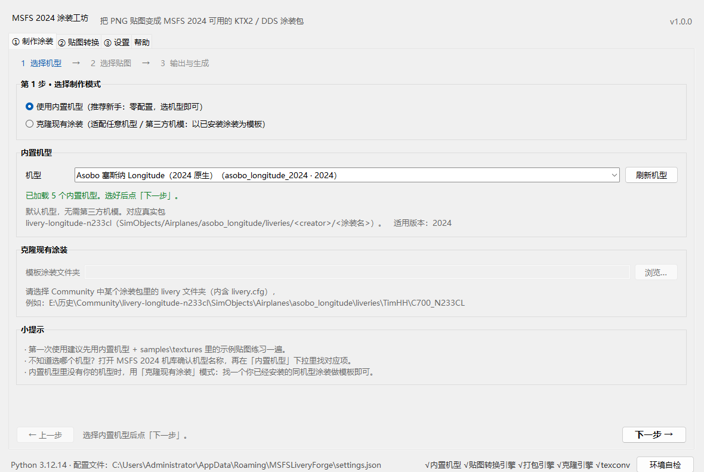
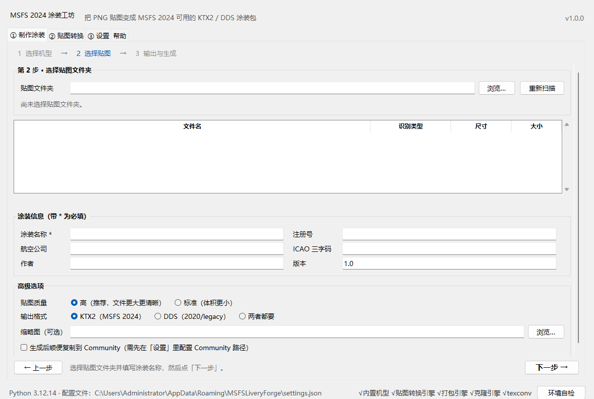

# MSFS Livery Forge · MSFS 2024 涂装工坊

> 给《微软模拟飞行 2024》做涂装的**桌面小工具**：你只需要准备 PNG/TIF 贴图，
> 它负责把贴图压缩成游戏认识的 **KTX2 / DDS**，并打包成可以直接放进 **Community**
> 的完整涂装包。全程中文、无需联网、无需安装 Python。



## 这是什么？（一句话）

**作者只准备贴图，剩下的交给工具。** 有两条路：

1. **内置机型**：选一个机型 → 选贴图文件夹 → 填涂装名 → 生成。适合新手，零配置；
2. **克隆现有涂装**：拿任意一个已安装的涂装当模板 → 换成你的贴图 → 生成。
   适合第三方机模、内置机型里没有的飞机。

> 只想把 PNG 转成 KTX2/DDS、不打包？用「贴图转换」页签即可。

## 系统要求

| 项目 | 要求 |
|---|---|
| 操作系统 | Windows 10 / 11（64 位） |
| 游戏 | **可选**。生成涂装包不需要启动游戏；要装进游戏才需要 MSFS 2024（2020 的 DDS 模式同理） |
| Python | **不需要安装**，项目自带便携运行时 `runtime\`（约 56 MB） |
| 显卡/驱动 | 无特殊要求（压缩使用内置 `tools\texconv\texconv.exe`） |
| 磁盘空间 | 发布包约 60 MB（含运行时、压缩工具与示例）；解压后约 80 MB |
| 网络 | **不需要联网**，本工具不访问网络 |
| 屏幕 | 建议 1366×768 以上（主窗口最小 1100×760） |

> ⚠ 移动项目文件夹时请**整个文件夹一起移动**，保持 `runtime\`、`tools\`、
> `liveryforge\` 的相对位置，否则启动器找不到运行时。

## 5 分钟上手

### 第 0 步：启动

双击项目根目录的 **`run_gui.bat`**（会弹出一个控制台窗口，这是正常的，用于显示日志）。
如果杀毒软件提示风险，见文末「常见问题」。

> 没有图形界面环境（例如远程终端）时，可用命令行：`run_cli.bat --help`。

### 路径 A：用内置机型（推荐第一次使用）

1. 打开「**① 制作涂装**」页签，模式选「**使用内置机型**」；
2. 在「机型」下拉框里选一个（没有第三方机模时**先用 Asobo 塞斯纳 Longitude**）；
3. 点「**下一步**」；
4. 在「**② 选择贴图**」里点「贴图文件夹」的 **浏览…**，选择你的 PNG/TIF 文件夹
   （可以先拿 `samples\textures` 练手）；
   - 列表会显示：文件名、识别类型（ALBD/COMP/NORM…）、尺寸、大小；
5. 填写「**涂装名称**」（必填），按需填写注册号、航空公司、ICAO 三字码、作者；
6. 点「**下一步**」→ 选择**输出目录** → 点「**⚙ 开始生成涂装包**」；
7. 完成后点「**打开输出目录**」查看生成的包；点「**复制到 Community**」装进游戏。

### 路径 B：克隆现有涂装（适配第三方机模）

1. 模式选「**克隆现有涂装**」；
2. 「模板涂装文件夹」选择一个**已安装涂装**的内部 livery 文件夹，例如：

   ```
   E:\历史\Community\livery-longitude-n233cl\SimObjects\Airplanes\asobo_longitude\liveries\TimHH\C700_N233CL
   ```

   判断标准：该文件夹里能看到 **`livery.cfg`**；
3. 选你的新贴图文件夹，填涂装名称，输出目录，开始生成；
4. 工具会复制模板的结构和未替换的贴图，把同名贴图换成你转换后的版本，
   并更新涂装名称、注册号等信息。

### 路径 C：只转换贴图

1. 打开「**② 贴图转换**」页签；
2. 选「贴图文件夹」和「输出目录」；
3. 选格式：`KTX2（MSFS 2024）` / `DDS（2020/legacy）` / `两者都要`；
4. 点「开始转换」；完成后「打开输出目录」，把 `.KTX2` / `.DDS` 放进涂装包的 `texture\` 目录。



### 让游戏识别到涂装

1. 在「**③ 设置**」页签设置 **Community 目录**（点「自动探测」通常就能找到）；
2. 生成完成后点「复制到 Community」（或手动把生成的包文件夹整个复制进去）；
3. 启动 MSFS 2024 → 机库/涂装选择界面即可看到新涂装。

> 2024 的 Community 通常是 `…\Community`；有些安装使用 `…\Community2024`。
> 以「设置」页签自动探测的结果为准，也可以手动选择。

## 输出物说明

### 2024 native 包（KTX2）

```
<输出目录>\<包名>\
├─ manifest.json          包信息（content_type 按机型为 LIVERY 或 AIRCRAFT）
├─ layout.json            文件清单（含大小/FILETIME）
└─ SimObjects\Airplanes\<机型>\liveries\<作者>\<涂装名>\
   ├─ livery.cfg          涂装名称/注册号/航司/ICAO 等
   ├─ texture\            *.PNG.KTX2 + *.PNG.KTX2.json（+ texture.cfg 回退配置）
   └─ thumbnail\          thumbnail.png / thumbnail_small.png 等
```

### 2020 legacy 包（DDS）

```
<输出目录>\<包名>\
└─ SimObjects\Airplanes\<变体名>\
   ├─ aircraft.cfg
   └─ TEXTURE.<代码>\     *.PNG.DDS + *.DDS.json + texture.CFG + thumbnail*.jpg
```

> `.KTX2.json` / `.DDS.json` 是游戏读取贴图参数必需的元数据，**不要删除**。

## 支持的内置机型（5 个）

| 机型 id | 中文名 | 适用版本 | 额外依赖 |
|---|---|---|---|
| `asobo_longitude_2024` | Asobo 塞斯纳 Longitude | 2024 | 无（游戏自带，**新手先用它**） |
| `fbw_a380x_2024` | FlyByWire A380X | 2024 | 需安装 FBW A380X 免费机模 |
| `pmdg_777_2024` | PMDG 777-300ER | 2024 | 需安装 PMDG 777-300ER，required_tags `b77w_ext,engine_gew`（建议优先用克隆模式，见下） |
| `ini_a350_900_2024` | iniBuilds A350-900 | 2024 | 需安装 iniBuilds A350-900，required_tags `ext_a359` |
| `fbw_a320neo_2020` | FlyByWire A320neo | 2020 legacy(DDS) | 需安装 FBW A320neo（生成 DDS 模式包） |

> 没有对应第三方机模时：**用 Longitude**，或者用「**克隆现有涂装**」模式适配任意机型。
> **PMDG 777、iniBuilds A350 等机模的涂装通常还带厂商专属文件**（如 PMDG 的 `livery.json`、
> `model.airframe/`）——内置 profile 生成的是纯涂装包，若机库不显示，请改用克隆模式
> （以已安装的同机型涂装为模板），这样会继承模板中的全部文件。
> 完整/最新列表以命令行 `python -m liveryforge list-profiles` 为准。

## 命令行用法（进阶用户）

双击 `run_cli.bat`（无参数会显示帮助并暂停）；也可以在项目根目录的「命令提示符」里直接运行：

```bat
:: 列出内置机型
run_cli.bat list-profiles

:: 探测 Community / texconv / 引擎状态
run_cli.bat detect

:: 只转换贴图（KTX2 + DDS 都输出）
run_cli.bat convert samples\textures -o 输出\贴图 --format both

:: 用内置机型生成涂装包
run_cli.bat build --profile asobo_longitude_2024 --textures samples\textures -o 输出 --title "我的座机" --atc-id B-1234 --author "你的名字"

:: 克隆现有涂装
run_cli.bat clone --template "E:\历史\Community\livery-longitude-n233cl\SimObjects\Airplanes\asobo_longitude\liveries\TimHH\C700_N233CL" --textures samples\textures -o 输出 --title "克隆涂装"
```

等价 Python 形式（自带运行时）：

```bat
runtime\python.exe -m liveryforge list-profiles
runtime\python.exe -m liveryforge build --profile asobo_longitude_2024 --textures samples\textures -o 输出 --title "我的座机"
```

命令退出码：`0` 成功、`1` 失败、`2` 参数错误。所有错误信息为中文。

## 贴图怎么准备

* **格式**：PNG（推荐）或 TIF；
* **命名**：**不强制**任何后缀，工具会自动根据文件名识别类型：
  `ALBD/ALBEDO`=基础色、`COMP`=材质(ORM)、`NORM`=法线、`EMIS/LIT`=自发光、`DECAL`=贴花；
  其他名字按通用贴图处理。建议保留 paintkit 原始文件名，只替换内容；
* **尺寸**：建议 **1024 / 2048 / 4096**（2 的幂）。不是 2 的幂也能转，工具会自动缩放并警告，
  但 UV 可能轻微偏移；
* **透明通道**：需要 alpha 的涂装（舷窗、贴花、边缘）导出 PNG 时**不要合并背景**，保留透明通道；
* **颜色**：MSFS 的 KTX2 按 PNG 的 sRGB 数值直接保存，不做线性转换——这是真实包的格式，
  游戏内若显得发白属于格式特性，详见 [docs/texture-guide.md](docs/texture-guide.md)。

## 常见问题（FAQ）

**Q1：生成时提示「未找到内置压缩工具 texconv.exe」？**
`tools\texconv\` 必须完整存在。重新解压完整安装包；若被杀毒软件隔离，见 Q8。

**Q2：提示「贴图转换引擎尚未就绪 / 打包引擎尚未就绪」？**
说明当前版本缺少对应模块（开发中）。可先用「贴图转换」页签转贴图；完整版会随包附带全部引擎。

**Q3：KTX2 和 DDS 有什么区别？该选哪个？**
* **KTX2**：MSFS 2024 的原生格式，2024 涂装包用这个（推荐）；
* **DDS**：MSFS 2020 的旧格式（legacy），2020 涂装包或部分旧机模用这个；
* 「两者都要」会同时输出，适合不确定或同时维护两个版本的人。

**Q4：尺寸不是 2 的幂可以吗？**
可以转换，工具会调用 texconv 自动缩放到 2 的幂并给出警告，但贴图 UV 可能轻微偏移，
所以**建议直接导出 1024/2048/4096**。

**Q5：质量选「高」还是「标准」？**
「高」对应 KTX2 的 `FL_BITMAP_QUALITY_HIGH`，压缩更精细、文件稍大，**推荐**；
「标准」体积更小、远景可能略糊。两者都不影响能否进游戏。

**Q6：自动探测找不到 Community？**
在「③ 设置」手动点「浏览…」选择。常见位置：
`C:\Users\<你的用户名>\AppData\Roaming\Microsoft Flight Simulator 2024\Packages\Community`，
或你安装时指定的数据盘（例如 `E:\历史\Community`、`E:\历史\Community2024`）。
也可以设置系统环境变量 `MSFS_COMMUNITY_DIR` 指向它。

**Q7：复制的包在游戏里看不到？**
1. 确认包复制到了正确的 Community 目录（生成后可用「打开输出目录」核对）；
2. 确认机模已安装（A380X/PMDG/iniBuilds 等第三方机型需要先在 Community 装好机模本体）；
3. PMDG/iniBuilds 等机型依赖 `required_tags`，内置 profile 已自动写入，不要手动删；
4. 重启游戏（Community 内容在启动时扫描）。

**Q8：杀毒软件报毒/误删文件？**
`texconv.exe`、`runtime\python.exe` 可能被启发式扫描误报。请把整个项目文件夹
加入杀软白名单后重新解压。本工具不联网、不写注册表、不修改官方包。

**Q9：提示缺少 Pillow？**
使用官方 `runtime\` 启动（`run_gui.bat`）即可；自己用系统 Python 运行时也可
`pip install pillow` 后运行 `python -m liveryforge.gui.app`。

**Q10：界面打不开 / 一闪而过？**
不要直接双击 `app.py`；请用 `run_gui.bat`。若仍有问题，在项目根目录打开命令行执行：

```bat
runtime\python.exe -m liveryforge.gui.app --self-check
```

把输出发给开发者。若 `runtime\` 缺失，运行 `packaging\build_runtime.ps1` 重新构建。

**Q11：能不能直接改官方涂装/机模？**
不能，也不建议。工具只生成**独立** Community 包，不修改官方文件。

**Q12：配置文件在哪？**
`%APPDATA%\MSFSLiveryForge\settings.json`（Community 路径、输出目录、作者名、默认质量等）。
删掉它会恢复默认设置。

## 目录结构

```
MSFS-Livery-Forge-v1.0.0/
├─ run_gui.bat / run_cli.bat     双击启动（优先用 runtime\python.exe）
├─ runtime\                      便携 Python 3.12 + Tkinter + Pillow（约 53 MB）
├─ tools\texconv\                内置贴图压缩工具（DirectXTex，MIT）
├─ liveryforge\                  程序模块（GUI / CLI / 纹理引擎 / 打包引擎 / 机型）
├─ samples\                      示例贴图与缩略图（练手用）
├─ docs\                         快速上手、贴图指南（含 6 张界面截图）
├─ examples\                     示例涂装包（Asobo Longitude 2024，生成结果可直接对照）
└─ packaging\                    便携运行时构建脚本、示例素材/截图生成脚本
```

> 开发仓库另含 `tests\`（198 个自动化测试）与 `docs\research\`（KTX2 格式研究资料），
> 两者不随发布包分发。

## 文档

* [docs/quickstart.md](docs/quickstart.md) —— 图文详细步骤、三种模式、故障排查
* [docs/texture-guide.md](docs/texture-guide.md) —— PNG→KTX2/DDS 原理、命名/尺寸/alpha、渲染问题
* [ARCHITECTURE.md](ARCHITECTURE.md) —— 开发者架构与接口契约

## 版权与第三方声明

* 本项目为第三方工具，与 Microsoft / Asobo Studio 无隶属关系。
  《Microsoft Flight Simulator》及其商标归 Microsoft 所有。
* **DirectXTex texconv.exe**：© Microsoft，MIT License；
  许可证见 `tools\texconv\LICENSE`（二进制随包分发，仅作贴图压缩）。
* **MSFSLayoutGenerator.exe**：MIT License，仅用于开发期校验 layout.json，
  产品流程不调用，见 `tools\MSFSLayoutGenerator\LICENSE`。
* **Pillow**：© Jeffrey A. Clark 与贡献者，HPND License（随便携运行时分发）。
* **Python 3.12**：© Python Software Foundation，PSF License（随便携运行时分发）。
* `samples\` 下的示例贴图由本项目脚本生成（`packaging\make_samples.py`），可自由使用。
* `docs\research\` 中的真实涂装结构/格式样本来自作者本机安装的第三方涂装，
  仅用于格式研究，**不随产品再分发**。
* 生成的涂装版权归其作者；发布到第三方平台前请遵守对应机模/涂装作者的许可条款。
* 更完整的第三方组件许可证清单见 [THIRD-PARTY-NOTICES.md](THIRD-PARTY-NOTICES.md)。
