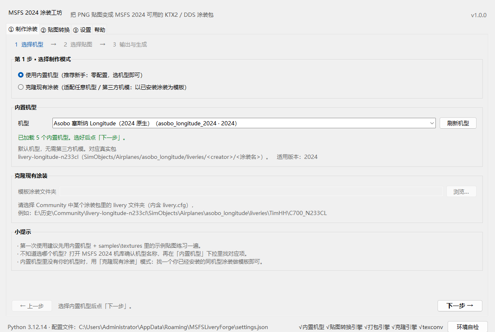
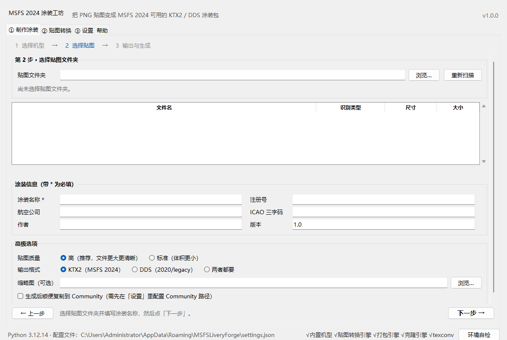
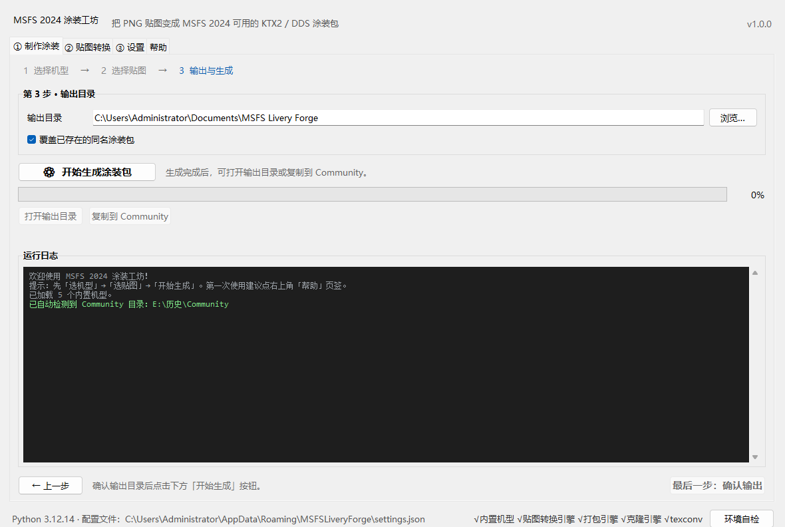
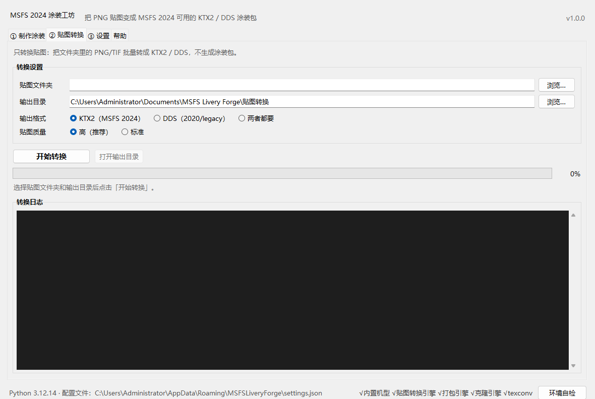
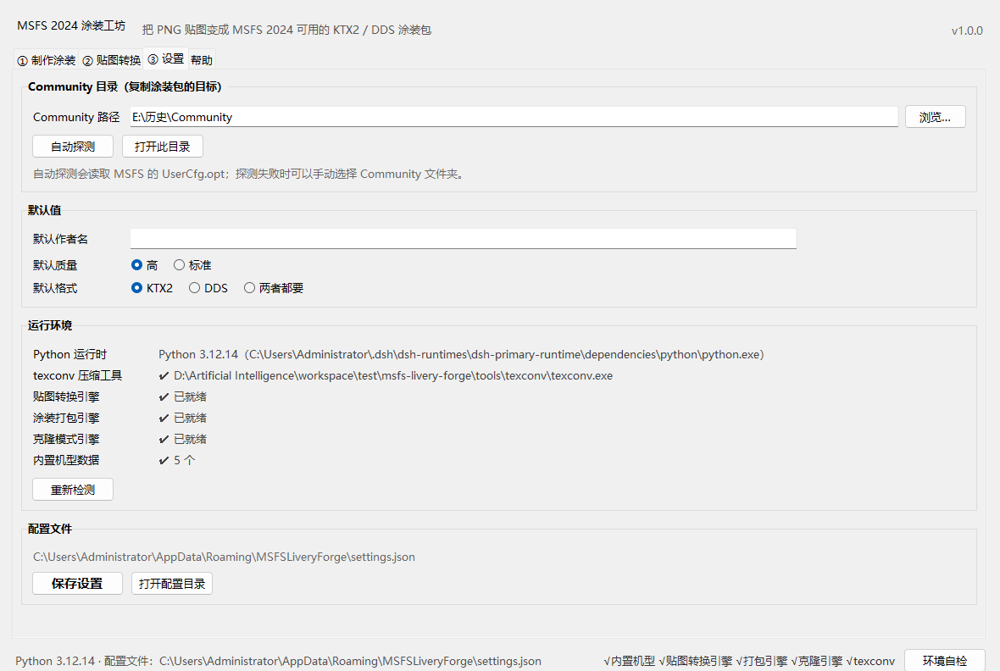

# 快速上手（图文详细版）

> 面向**第一次用、不是程序员**的涂装作者。照着做一遍大约 5 分钟。
> 只想看最短步骤？回到 [README 的 5 分钟上手](../README.md#5-分钟上手)。

---

## 1. 启动前先看一眼文件夹

项目解压后长这样（不用记，知道 `run_gui.bat` 在哪就行）：

```
msfs-livery-forge\
├─ run_gui.bat    ← 双击这个
├─ run_cli.bat
├─ runtime\       ← 自带的 Python，不用你安装
├─ tools\texconv\ ← 自带的压缩工具，不用你安装
├─ samples\       ← 示例贴图，练手用
└─ ...
```

**双击 `run_gui.bat` 会同时弹出一个黑色控制台窗口**——不要关它！
它是程序的日志窗口，程序运行时需要它存在；关掉控制台 = 关闭程序。

主界面如下：



界面顶部是标题栏，中间是 4 个页签：

| 页签 | 用途 |
|---|---|
| ① 制作涂装 | 主流程：选机型 → 选贴图 → 输出 + 生成 |
| ② 贴图转换 | 只把 PNG/TIF 转成 KTX2/DDS，不打包 |
| ③ 设置 | Community 路径、默认作者名、环境自检 |
| 帮助 | 内置简明说明、打开示例/文档目录 |

底部状态栏显示 Python 版本、配置文件路径、各引擎是否就绪。**看到绿色的「✔」就说明能用了。**

---

## 2. 路径 A：内置机型（推荐第一次）

### 第 1 步：选择机型

1. 进入「**① 制作涂装**」；
2. 模式选「**使用内置机型（推荐新手）**」；
3. 在「机型」下拉里选择：

   ```
   1  选择机型  →  2  选择贴图  →  3  输出与生成
   ```

   * **Asobo 塞斯纳 Longitude**：游戏自带，谁都能用，**第一次就选它**；
   * FlyByWire A380X / PMDG 777-300ER / iniBuilds A350-900：需要你先安装对应第三方机模；
   * FlyByWire A320neo（2020 legacy）：生成的是 2020 版 DDS 涂装包。

   下拉框下方会显示该机型的说明与前置条件。没有第三方机模？直接选 Longitude，或用路径 B。

4. 点右下角「**下一步 →**」。

> 如果下拉框提示「暂无内置机型」，说明机型数据缺失；此时可以用「克隆现有涂装」模式（路径 B）。

### 第 2 步：选择贴图 + 填写信息



1. 点「贴图文件夹」右边的「**浏览…**」，选择存放 PNG/TIF 的文件夹；
   * 第一次不知道选什么？选项目里的 **`samples\textures`**，里面有 3 张示例贴图；
   * 工具会自动扫描（含子文件夹），并按文件名识别类型；
2. 列表出现后检查：
   * 「文件名」「识别类型」是否正确（基础色 ALBD / 材质 COMP / 法线 NORM…）；
   * 「尺寸」是否为 512/1024/2048/4096；
   * 数量与总大小是否和你的预期一致；
3. 填写「涂装信息」：
   * **涂装名称***（必填，会显示在游戏机库里）；
   * 注册号（例如 `B-1234`）、航空公司、ICAO 三字码（例如 `CES`）、作者名、版本；
4. 「高级选项」（一般不用改）：
   * **贴图质量**：高（推荐）/ 标准；
   * **输出格式**：KTX2（2024）/ DDS（2020 legacy）/ 两者都要；
   * **缩略图**：可选，选一张 16:9 截图；不选会自动生成占位图；
   * **生成后顺便复制到 Community**：需要先在「③ 设置」里配置 Community 路径；
5. 点「**下一步 →**」。

> 贴图命名没有强制后缀，工具会自动识别；如果尺寸不是 2 的幂会提示，并自动缩放（可能 UV 轻微偏移）。
> 更多规则见 [texture-guide.md](texture-guide.md)。

### 第 3 步：输出目录 + 生成



1. 选择「**输出目录**」（默认在“我的文档\MSFS Livery Forge”）；
2. 需要覆盖同名包时勾选「覆盖已存在的同名涂装包」；
3. 点「**⚙ 开始生成涂装包**」；
4. 观察进度条与日志（逐文件进度，不会卡界面）：
   * 生成过程中**不要关闭控制台窗口**；
   * 如果失败会弹中文错误框并给出建议，日志里可以复制原因；
5. 看到绿色「✅ 生成完成」后：
   * 「**打开输出目录**」查看包结构；
   * 「**复制到 Community**」安装到游戏（需先设置 Community 路径）。

生成物结构（2024 KTX2 模式）：

```
<包名>\
├─ manifest.json
├─ layout.json
└─ SimObjects\Airplanes\<机型>\liveries\<作者>\<涂装名>\
   ├─ livery.cfg
   ├─ texture\     *.PNG.KTX2 + *.PNG.KTX2.json
   └─ thumbnail\   thumbnail.png 等
```

> 复制完成 → **重启 MSFS 2024** → 机库/涂装选择界面即可看到。

---

## 3. 路径 B：克隆现有涂装（第三方机模 / 没有内置机型时）

原理：找一个**已经安装好、能正常显示**的同机型涂装作为「模板」，工具复制它的包结构，
再用你的贴图替换同名贴图，并更新名称/注册号。

1. 模式选「**克隆现有涂装**」；
2. 「模板涂装文件夹」选到 **livery 层**：

   ```text
   E:\历史\Community\livery-longitude-n233cl\SimObjects\Airplanes\asobo_longitude\liveries\TimHH\C700_N233CL
                                                                                        ↑ 选到这里
   ```

   判断标准：**这个文件夹里有 `livery.cfg`**。选错了「下一步」会提示。
3. 选贴图文件夹，填涂装名称，点「下一步」；
4. 选输出目录 →「开始生成」；
5. 工具会在日志里说明：哪些模板贴图被你的贴图替换了、哪些保留原样。

> 模板里没有的贴图不会凭空生成；建议把 paintkit 的全部贴图放进去，至少放你改过的那几张。
> 2020 legacy 模板会生成 DDS 包；2024 模板生成 KTX2 包。

---

## 4. 路径 C：只转换贴图（不打包）



1. 进入「**② 贴图转换**」；
2. 选「贴图文件夹」和「输出目录」；
3. 选「输出格式」：
   * **KTX2（MSFS 2024）**；
   * **DDS（2020/legacy）**；
   * **两者都要**；
4. 选质量（高/标准），点「**开始转换**」；
5. 完成后「打开输出目录」，你会得到：

   ```
   EXAMPLE_FUSELAGE_ALBD.PNG.KTX2
   EXAMPLE_FUSELAGE_ALBD.PNG.KTX2.json
   EXAMPLE_FUSELAGE_ALBD.PNG.DDS       （如果选了 DDS / both）
   EXAMPLE_FUSELAGE_ALBD.PNG.DDS.json
   ...
   ```

6. 把这些文件放进你自己的涂装包 `texture\` 目录即可（注意 `.json` 不要漏）。

---

## 5. 设置页（Community / 作者名 / 环境自检）



* **Community 路径**：点「自动探测」自动读取 MSFS 的 `UserCfg.opt`；
  找不到就「浏览…」手动选。常见位置：
  `…\Microsoft Flight Simulator 2024\Packages\Community` 或 `E:\历史\Community`。
* **默认作者名**：生成时自动填入作者字段（可在主流程里临时改）。
* **运行环境**：显示 texconv / 各引擎 / 机型的就绪情况，出问题先看这里，点「重新检测」刷新。
* **保存设置**：配置保存到 `%APPDATA%\MSFSLiveryForge\settings.json`，下次启动自动加载。

---

## 6. 命令行（可选）

不想用界面、或想批量处理时，双击 `run_cli.bat` 会显示帮助；也可以：

```bat
run_cli.bat list-profiles
run_cli.bat detect
run_cli.bat convert samples\textures -o 输出\贴图 --format both
run_cli.bat build --profile asobo_longitude_2024 --textures samples\textures -o 输出 --title "我的座机"
run_cli.bat clone --template "E:\历史\Community\...\C700_N233CL" --textures samples\textures -o 输出 --title "克隆涂装"
```

每个命令都会逐行打印进度，结束时输出摘要；失败时给出中文原因和解决建议。

---

## 7. 流程图（ASCII）

```
               ┌──────────────────────────────┐
               │ 双击 run_gui.bat             │
               └──────────────┬───────────────┘
                              │
              ┌───────────────┴────────────────┐
              │ 选择制作模式                    │
              ├───────────────┬────────────────┤
              │ 内置机型       │ 克隆现有涂装    │
              └───────┬───────┴────────┬───────┘
                      │                │
              ┌───────┴───────┐  ┌─────┴──────────────┐
              │ 选机型 profile │  │ 选模板 livery 文件夹 │
              └───────┬───────┘  └─────┬──────────────┘
                      └───────┬────────┘
                              ▼
                 ┌─────────────────────────┐
                 │ 选贴图文件夹（PNG/TIF）   │
                 │ 扫描 → 识别类型/尺寸/大小 │
                 └────────────┬────────────┘
                              ▼
                 ┌─────────────────────────┐
                 │ 填涂装名/注册号/航司/作者 │
                 │ 高级：质量/格式/缩略图    │
                 └────────────┬────────────┘
                              ▼
                 ┌─────────────────────────┐
                 │ 选输出目录 → 开始生成     │
                 │ 后台线程：texconv 压缩    │
                 │ → KTX2/DDS + json        │
                 │ → livery.cfg/manifest/   │
                 │   layout/thumbnail       │
                 └────────────┬────────────┘
                              ▼
              ┌──────────────────────────────┐
              │ 打开输出目录 / 复制到 Community │
              │ → 重启 MSFS 2024 查看涂装      │
              └──────────────────────────────┘
```

---

## 8. 出问题怎么办（速查）

| 现象 | 可能原因 | 处理 |
|---|---|---|
| 双击 run_gui.bat 一闪而过 | runtime 缺失 / 杀软拦截 | 看控制台最后一行；重新解压或运行 `packaging\build_runtime.ps1` |
| 提示找不到 python | runtime 或系统 Python 都没有 | 用完整安装包；或安装 Python 3.10–3.12 勾选 Add to PATH |
| 主界面能开，但生成按钮报「引擎未就绪」 | 版本缺少模块 | 用「贴图转换」页签先转贴图；更新完整版本 |
| 提示 texconv.exe 缺失 | 工具目录不全/被杀软隔离 | 加入白名单后重新解压 `tools\texconv\` |
| 转换很慢或卡住 | 贴图很大（4K×多张） | 属正常压缩耗时，等待日志继续；可先缩到 2048 试 |
| 游戏里找不到涂装 | Community 路径不对/机模未装/未重启 | 检查设置页、确认机模已安装、重启游戏 |
| 游戏里颜色发白 | KTX2 的 sRGB 数值直存特性 | 见 [texture-guide.md 色彩空间](texture-guide.md#色彩空间为什么有的贴图看起来发白) |
| 贴图出现接缝/错位 | 尺寸非 2 的幂被自动缩放 | 改为 1024/2048/4096 重新导出 |
| 想恢复默认设置 | 配置损坏/乱改 | 删除 `%APPDATA%\MSFSLiveryForge\settings.json` |

更完整的问答见 [README 常见问题](../README.md#常见问题faq)。
